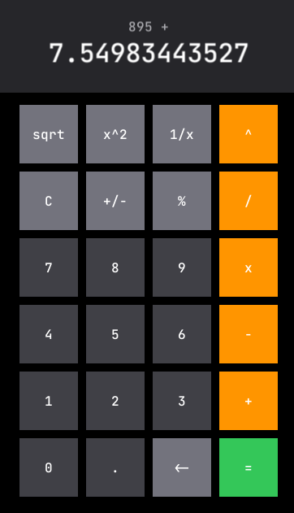

# cppui - A C++ framework for creating performant, cross-platform desktop apps

What if building a UI in C++ felt just a bit less painful?
Introducing **cppui**: small, fast, and (hopefully) a bit fun to use.

## Code example
```cpp
#include "app.h"

Font font = GetFont("JetBrainsMono.ttf", 16.0f);

int number = 0;

void increment_number()
{
    number++;

    app.GetChild("counter", true)->ChangeText("The button was pressed " + std::to_string(number) + " times");
}

App Application()
{
    debug("hello world!");

    // clang-format off
    return App({
        HorizontalContainer({
            VerticalContainer({
                Text("hello world!", font, WHITE),
                Text("The button was pressed 0 times", font, WHITE)->setID("counter"),
                Button(increment_number, WHITE, {
                    Text("Click me!", font, BLACK),
                }),
            }),
            Image("cat.png", {80, 80}),
        })
    });
    // clang-format on
}
```

## A simple calculator app made with cppui


## What is cppui?
cppui is a small C++ framework that can help developers create simple and performant apps in C++, with a component-based React feel.

Instead of manually positioning rectangles and working with a rendering loop, you describe your UI as a tree of components, and cppui takes care of laying it out and rendering it.

## How it works

Every cppui app is a tree. Components go inside other components, and the whole thing is handed to `App`.
There are 2 types of components:

- **Containers** (`HorizontalContainer`, `VerticalContainer`) arrange their children in a row or a column
- **Widgets** (`Text`, `Button`, `Image`) are the things you actually see and click

Looking at the example above, the tree is:

```
App
└── HorizontalContainer
    ├── VerticalContainer
    │   ├── Text ("hello world!")
    │   ├── Text ("The button was pressed 0 times")   [id: counter]
    │   └── Button
    │       └── Text ("Click me!")
    └── Image (cat.png)
```

Components can be given an ID with `setID(...)`, and later looked up with `app.GetChild(...)`. That's how the button in the example updates the counter text: it finds the component by ID and changes its text.

Under the hood, everything is drawn with the awesome [SDL](https://www.libsdl.org/) library, so the same code works on Windows, macOS and Linux.

## Why cppui?

A cppui app compiles down to a native binary, with no browser engine or runtime shipped alongside it. It uses under 15 MB of memory on average for a simple application (around 12 MB for the calculator example app).

cppui isn't trying to replace Qt or Dear ImGui. It's aiming to provide an easy way to create a simple GUI, without a steep learning curve or a pile of boilerplate.

## Quick start

1. Download the latest release of cppui
2. Copy the include/ and lib/ folders to your project's root
3. Create a C++ file with an `Application()` function like the one in the example above
4. Link against the cppui library and run it

Linking cppui example for Linux and MinGW:
```bash
g++ app.cpp -Iinclude -Llib -lcppui -o app
./app
```

## Documentation
~~You can find a documentation folder including every component type, and some best practices [here](docs/README.md).~~ **Documentation coming soon!**

## Current state

cppui is still a work in progress, and the API might change as it grows. The calculator example is the biggest thing I've built with it so far, and it held up pretty well!

## Future plans

Ideas for improving the framework:

- Add documentation
- More components (text inputs, checkboxes, sliders, scroll views...)
- Styling options like borders and rounded corners
- Better layout controls (alignment, spacing, sizing)
- More example apps

## Third-Party libraries used
- [SDL](https://www.libsdl.org/): the rendering backend cppui uses
- [SDL_ttf](https://github.com/libsdl-org/SDL_ttf): for font loading and text rendering
- [SDL_image](https://github.com/libsdl-org/SDL_image): for rendering image files

## Building cppui from source
cppui uses CMake, alongside a custom python build system to merge SDL static libraries to create a standalone library.

To build cppui, run:
```bash
python build.py
```
alongside any other arguments you want to be forwarded to CMake. For example:
```bash
python build.py -DCMAKE_BUILD_TYPE=Release -DCMAKE_TOOLCHAIN_FILE=...
```

You will need CMake, ninja or make, and SDL3, SDL3_image, and SDL3_ttf installed in a directory where CMake can find them.

## Contributing

Contributions are greatly appreciated! If you have a new component idea or improvement, don't hesitate to open a PR!

## License

This project is licensed under the [MIT License](LICENSE).